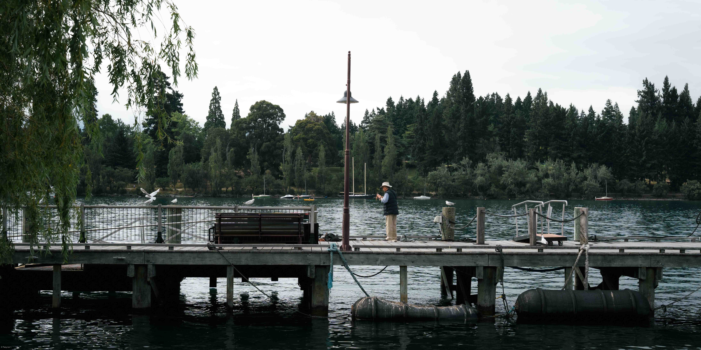

<h2 align="center">⟡ ⋆ ────────&emsp;<strong>𝐉𝐂 𝐋𝐈𝐍</strong>&emsp;──────── ⋆ ⟡</h1>

<h3 align="center">Electrical Engineering Student @ NTHU</h2>

  

  
    A quiet lakeside moment in Queenstown, New Zealand · 50mm · f/8 · 1/320s · ISO 160
  

## 📸 **About me** 
- Interested in <strong>artificial intelligence, computer vision, and computational photography</strong>.
- Currently exploring <strong>self-localization within floorplans</strong>.
- Passionate about <strong>photography</strong> and <strong>visual storytelling</strong>.
## 🔬 **Projects**
- [LMOL on SCUT-FBP5500](https://github.com/ljc-1222/lmol-scut-fbp5500)

  A reproduction of the ICASSP 2025 LMOL method for facial beauty prediction on SCUT-FBP5500. It fine-tunes LLaVA-1.5-7B for pairwise face comparisons using first-answer-token classification, then recovers absolute ratings through Bradley–Terry estimation.

- [Marine Debris Detection](https://github.com/ljc-1222/Marine-Debris-Detection)

  Won first place in both detection and lightweight optimization at the 2026 International Marine Debris Image Recognition AI Challenge (81.60% mAP@0.5). The 34-class system combines four detectors, weighted boxes fusion, and DINOv3/SigLIP 2 crop classifiers for rescoring and label recovery.

- [BRnFS — Bokeh Rendering & Focus Stacking](https://github.com/ljc-1222/bokeh-rendering-focus-stacking-suite)

  A computational photography suite for rendering shallow-depth-of-field bokeh from a single image and fusing multi-focus photographs into an all-in-focus result. It combines depth-based scene processing, image alignment, Laplacian-pyramid fusion, and a unified GUI/CLI.

- [Interactive Marginal Distortion Correction](https://github.com/ljc-1222/marginal-distortion-correction)

  An interactive implementation of MaDCoW for correcting distortion in wide-angle photographs and panorama views. SAM2-assisted region selection and snapped line annotations provide constraints for global mesh optimization, letting users guide both object appearance and scene geometry.

- [A2C2 on OpenPI-Comet](https://github.com/ljc-1222/behavior-a2c2)

  An implementation of multimodal residual action correction on a frozen OpenPI-Comet policy for BEHAVIOR-1K. Four loss variants were evaluated on Task 1: offline action errors decreased, but closed-loop performance remained below the unmodified policy.

- **Self-localization within a Floorplan** (Research in progress; repository private)

  Research on estimating camera poses from RGB observations and known 2D floorplans. The Structured3D-based implementation extends SemRayLoc with a room-aware HoHoNet Stage 1 and a native-grid pose-posterior Stage 2.

## 📓 **Corese Works**
- [EE341000 Algorithms](https://github.com/ljc-1222/EE341000-Algorithms)
- [EE366200 Digital Signal Processing Laboratory](https://github.com/ljc-1222/EE366200-Digital-Signal-Processing-Laboratory)
- [EE655000 Machine Learning](https://github.com/ljc-1222/EE655000-Machine-Learning)
- [EE662000 Computational Photography](https://github.com/ljc-1222/EE662000-Computational-Photography)
- [AIA500500 Deep Learning--NYCU](https://github.com/ljc-1222/AIA500500-Deep-Learning--NYCU)
  
